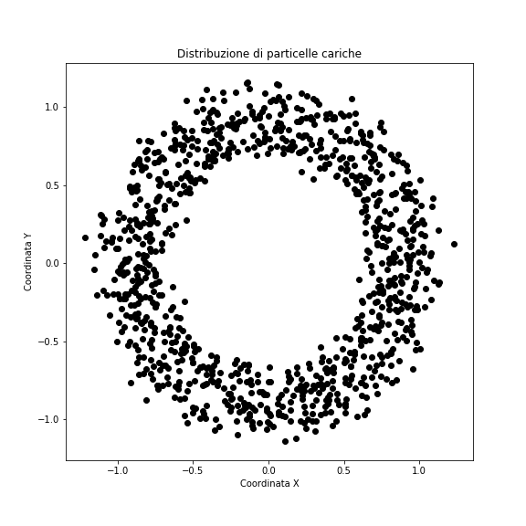

# 💻 Laboratorio di Informatica 8

### Prof. Stefano Carrazza - Corso C

**Riassunto:** Esercizi di base in C++: strutture dati, funzioni, headers e sorgenti.

Prima di iniziare suggeriamo di creare una cartella per questa lezione in cui potete salvare tutti i file che saranno creati per gli esercizi.

```bash
cd ~/           # ci porta alla home directory
mkdir lezione8  # crea la directory sulla vostra home
cd lezione8     # entrate dentro la cartella
```

Dopodiché creare un `makefile` con le istruzioni di compilazione per tutti gli esercizi.

-----

### 🍎 Esercizio 1 - Hello World struct 1

Scrivere un programma in C++ in cui:

1.  Definiamo la struttura seguente:
    ```c++
    struct prodotto {
      int peso;
      double prezzo;
      string nome;
    };
    ```
2.  Dentro il `main` inizializziamo un `prodotto` con `nome` **"banana"**, `peso` di **200g** e `prezzo` di **2.5 euro**, usando l'**inizializzazione a elenco** (attenzione all'ordine dei membri!).
3.  Scriviamo una funzione `void stampa_prodotto` che prende per argomento `prodotto` e stampa:
    ```
    Prodotto:
      - nome: *stampare nome*
      - peso: *stampare peso*
      - prezzo: *stampare prezzo*
    ```
    Sostituire i valori tra asterischi con i valori salvati nell'oggetto prodotto inizializzato al punto precedente.

-----

### 🛒 Esercizio 2 - Hello World struct 2

Scrivere un programma in C++ in cui:

1.  Definiamo la struttura `prodotto` presentata sopra.
2.  Inizializziamo un **array dinamico** di `prodotto` con dimensione massima di **4 elementi**.
3.  Chiediamo all'utente quanti prodotti vuole inserire (al massimo **4**, altrimenti il programma termina con un messaggio di errore) e poi, per ciascuno, il nome, il peso e il prezzo. Il nome deve essere composto da **una sola parola**, perché `cin >>` si ferma al primo spazio.
4.  Implementare una funzione `void fattura(prodotto *p, int size);` che prende come argomento l'array dinamico e il numero di prodotti inseriti, e stampa la tabella seguente, con le colonne separate da una tabulazione (`"\t"`):
    ```
    Fattura
    --------------------------------
    Nome    Peso    Prezzo
    --------------------------------
    *prodotto 1*    *peso1*    *prezzo1*
    *prodotto 2*    *peso2*    *prezzo2*
    ...
    --------------------------------
    Totale (euro): *prezzo totale*
    --------------------------------
    ```
5.  Verificare che il programma funzioni correttamente, anche con meno di 4 prodotti.

-----

### ➕ Esercizio 3 - Vettori

Scrivere un programma in C++ in cui dei vettori 3D vengono salvati in una struttura dati:

```c++
struct vettore {
  double x;
  double y;
  double z;
};
```

1.  Scrivere la funzione `main` e dichiarare **2 variabili** di tipo `vettore` chiamate `a` e `b` rispettivamente.
2.  Assegnare ad `a` il vettore **(-1, 2, -3)**.
3.  Assegnare a `b` il valore di `a` con **un'unica istruzione**.
4.  Implementare una funzione `scalar` di tipo `double` che calcola il **prodotto scalare** tra 2 oggetti di tipo `vettore`. Testare tale funzione direttamente sul `main` passando `a` e `b` come argomenti e stampando il risultato su terminale.
5.  Implementare una funzione `somma` di tipo `vettore` che prende come argomenti 2 oggetti `vettore` e ritorna un nuovo oggetto `vettore` in cui le coordinate corrispondono alla **somma delle coordinate** degli argomenti. Stampare le coordinate del nuovo vettore su terminale.

> **Suggerimento:** le funzioni leggono gli argomenti senza modificarli: passateli per **riferimento costante** (`const vettore &a`).

-----

### ⚙️ Esercizio 4 - Headers e sorgente

Spostare la struttura `vettore` e le sue funzioni dell'Esercizio 3 in file separati e usarle per un problema di fisica.

1.  Creare un file header `vettore.h`, protetto da un **include guard** (`#ifndef VETTORE_H` ... `#endif`), che contiene:
    - la definizione della struttura `vettore`;
    - le dichiarazioni delle funzioni `scalar` e `somma` dell'Esercizio 3;
    - la dichiarazione di una funzione `double modulo(const vettore &a)` che restituisce il modulo del vettore;
    - la dichiarazione di una funzione `void stampa(const vettore &v)` che stampa il vettore nel formato `(x, y, z)`.
2.  Creare un file `vettore.cc` che include `vettore.h` e implementa le quattro funzioni.
3.  Creare un file `esercizio4.cc` che include `vettore.h` e, data una forza **F = (3, 0, 4) N** che agisce su un corpo spostato prima di **s1 = (2, 0, 0) m** e poi di **s2 = (0, 1, 0) m**, calcola e stampa:
    - lo spostamento totale **s = s1 + s2**;
    - il modulo della forza **|F|**;
    - il lavoro **W = F · s**.
4.  Verificare il ruolo dell'include guard: includere `vettore.h` **due volte** in `esercizio4.cc` e controllare che il programma compili. Poi commentare le righe `#ifndef`, `#define` e `#endif` e osservare l'errore del compilatore.
5.  Aggiornare il `makefile`: il comando di compilazione deve contenere tutti i file `*.cc`, e la regola deve dipendere anche da `vettore.h`.

-----

### 🧲 Esercizio 5 - Particelle cariche

Copiare nella cartella `lezione8` il file `data.dat` di questa lezione. Il file contiene le coordinate cartesiane `x y` di **1000 particelle cariche**, una particella per riga, che si muovono in un campo magnetico con sorgente centrata in `(0,0)`:



Le particelle hanno due diversi valori dell'impulso e, poiché il raggio di curvatura è $r = p/(qB)$, si dispongono su **due anelli** di raggio circa **0.8** e **1.0**.

1.  Definire la struttura:
    ```c++
    struct particella {
      double x; // coordinata x
      double y; // coordinata y
      double r; // distanza dalla sorgente in (0,0)
    };
    ```
2.  Allocare un **array dinamico** di 1000 `particella` e leggere dal file le coordinate di tutte le particelle, controllando che il file sia stato aperto correttamente.
3.  Implementare una funzione `double distanza(const particella *p)` che riceve il **puntatore** a una particella e ne restituisce la distanza dall'origine, usando l'operatore `->`. Usarla per salvare la distanza `r` di ogni particella.
4.  Implementare una funzione `void istogramma(const particella *p, int n, double rmin, double rmax, int nbin)` che conta le particelle in ciascuno degli `nbin` intervalli di `r` tra `rmin` e `rmax` e stampa un istogramma testuale (es. un `*` ogni 4 particelle). Usare `rmin = 0.6`, `rmax = 1.25` e `nbin = 13`: si riconoscono i due anelli?
5.  Implementare una funzione `void anelli(const particella *p, int n, double soglia)` che separa le particelle con la condizione `r < soglia` e stampa, per ciascun anello, il **numero di particelle** e il **raggio medio**. Usare `soglia = 0.9` e verificare che i raggi medi siano vicini ai valori attesi.
6.  Liberare la memoria allocata.

> **Domanda:** guardando l'istogramma, i due anelli sono ben separati? Che cosa succede alle particelle vicine alla soglia?

-----

### 🧠 Esercizi Opzionali per l'approfondimento

Questi esercizi sono consigliati per approfondire i concetti della lezione.

1. **Prodotto Maggiore**

    A partire dalla struttura `prodotto` dell'Esercizio 1 e 2:

    - Implementare una funzione `prodotto* trova_maggiore(prodotto *p, int size);` che riceve un array dinamico di prodotti e restituisce un **puntatore** al prodotto con il prezzo maggiore.
    - Nel `main`, inizializzare un array di almeno 3 prodotti e utilizzare la funzione per trovare e stampare il nome e il prezzo del prodotto più costoso.

2. **Strutture Annidate: Data**

    Scrivere un programma in C++ che utilizza strutture dati annidate.

    1.  Definire la struttura `data_cal` per rappresentare una data:
        ```c++
        struct data_cal {
          int giorno;
          int mese;
          int anno;
        };
        ```
        > **Nota:** non chiamate la struttura `data`: con `using namespace std` il nome entra in conflitto con la funzione `std::data` della libreria standard e il compilatore `g++` segnala un errore.
    2.  Definire la struttura `evento` che contiene un `string nome` e un oggetto `data_cal`:
        ```c++
        struct evento {
          string nome;
          data_cal data_evento;
        };
        ```
    3.  Nel `main`, creare un oggetto `evento` (es. "Compleanno", data 10/12/2025) e una funzione `void stampa_evento(evento e)` che stampa i dettagli dell'evento, incluso il formato della data (Giorno/Mese/Anno).

3. **Headers e Vettori (Prodotto Vettoriale)**

    A partire dai file dell'Esercizio 4:

    1.  Aggiungere al file header `vettore.h` una dichiarazione per una nuova funzione `vettore prodotto_vettoriale(const vettore &a, const vettore &b);`.
    2.  Nel file `vettore.cc`, implementare la funzione `prodotto_vettoriale` che calcola il **prodotto vettoriale** tra i due vettori 3D e restituisce il `vettore` risultante.
        > Il prodotto vettoriale $c = a \times b$ ha coordinate $c_x = a_y b_z - a_z b_y$, $c_y = a_z b_x - a_x b_z$, $c_z = a_x b_y - a_y b_x$.
    3.  In un nuovo file `opzionale3.cc`, testare la nuova funzione e stampare le coordinate del vettore risultato del prodotto vettoriale tra `a = (1, 0, 0)` e `b = (0, 1, 0)`.
